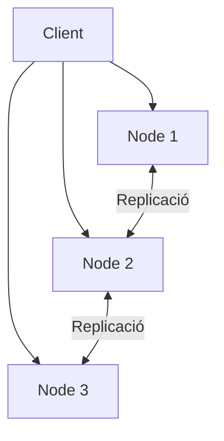

---
hide:
  - navigation
---
# 4. Emmagatzematge distribuït

## Principi

En un sistema distribuït, les dades es reparteixen o es repliquen entre diferents màquines o nodes. D’aquesta manera es pot augmentar la disponibilitat, repartir la càrrega i evitar que una sola màquina siga un punt únic de fallada.

## Tècniques habituals

| Tècnica | Idea principal | Avantatge | Cost o risc |
| --- | --- | --- | --- |
| Replicació | Mantindre diverses còpies dels mateixos blocs o fitxers | Disponibilitat i recuperació davant la fallada d’un node | Consuma més espai i pot replicar errors |
| Fragmentació | Repartir parts de les dades entre nodes | Escalabilitat i repartiment de càrrega | Una incidència pot afectar un fragment |
| Paritat | Guardar informació calculada per reconstruir dades | Redueix l’espai respecte de duplicar-ho tot | Càlcul i reconstrucció més complexos |
| Codificació d’esborrat | Dividir dades i afegir fragments de recuperació | Eficiència en grans sistemes | Més latència i complexitat |

## On s’utilitza?

És habitual en serveis de núvol, centres de dades, clústers, plataformes web i sistemes d’objectes. En una pime, un NAS amb diversos discos ja pot oferir una part de la idea, però no equival necessàriament a un sistema distribuït entre ubicacions.

## Replicació síncrona i asíncrona

- **Síncrona:** una escriptura no es dona per completada fins que els nodes requerits l’han confirmada. Redueix la pèrdua de dades, però pot afegir latència.
- **Asíncrona:** el node principal confirma abans i replica després. Té millor rendiment, però una fallada sobtada pot deixar dades pendents de replicar.

La decisió depén del RPO, el RTO, la distància entre nodes i el cost assumible.

## Què no resol un sistema distribuït?

La replicació pot reproduir una eliminació, una corrupció o el xifrat per ransomware. Per això cal combinar-la amb versions, còpies independents, controls d’accés i una còpia fora de línia o immutable quan el risc ho justifique.

| Problema | Possible mesura |
| --- | --- |
| Fallada d’un node | Replicació o paritat |
| Tall de xarxa | Nodes i rutes redundants |
| Eliminació accidental | Paperera, versions i backup |
| Ransomware | Còpia aïllada i credencials separades |
| Destrucció d’una seu | Còpia en una altra ubicació |

## Diferència amb RAID

RAID combina discos dins d’un sistema d’emmagatzematge. Un sistema distribuït pot combinar màquines, xarxes i ubicacions diferents. Tots dos poden oferir redundància, però actuen en escales i punts de fallada diferents.

## Repte de disseny

Dibuixa una proposta per a una empresa amb dos nodes, una còpia externa i quinze usuaris. Indica:

1. quines dades es repliquen;
2. quina incidència resol cada còpia;
3. què passaria si es replica un fitxer xifrat per ransomware;
4. com separaries els permisos de producció i de backup.

[Següent: còpies de seguretat](05-copies-seguretat.md) · [Pàgina principal de la UP2](../ut2-emmagatzematge.md)
