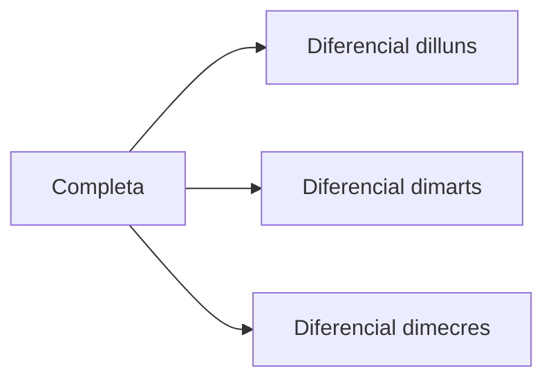

---
hide:
  - navigation
---
# 5. Còpies de seguretat

## Què és un backup?

Una **còpia de seguretat** és una còpia addicional de la informació que es manté per poder restaurar-la. Una còpia només és útil si conté les dades correctes, està disponible, no ha quedat afectada per la mateixa incidència i es pot restaurar.

## Tipus de còpia

### Completa

Copia totes les dades seleccionades cada vegada.

```text
Dilluns:  A B C D
Dimarts:  A B C D
Dimecres: A B C D
```

És senzilla de restaurar, però consumeix més temps i espai.

### Incremental

Només copia els canvis produïts des de l’última còpia, siga completa o incremental.


Consumeix poc espai i és ràpida, però per restaurar l’últim estat cal la completa i totes les incrementals posteriors.

### Diferencial

Copia els canvis produïts des de l’última còpia completa.



Creix al llarg dels dies, però per restaurar només cal la completa i l’última diferencial.

## Comparació

| Tipus | Espai | Temps de còpia | Restauració |
| --- | --- | --- | --- |
| Completa | Alt | Alt | Molt senzilla |
| Incremental | Baix | Baix | Completa + totes les incrementals |
| Diferencial | Mitjà | Mitjà | Completa + última diferencial |

## Freqüència i impacte

La freqüència depén de la quantitat de dades que l’organització pot perdre. Una base de dades que canvia cada cinc minuts necessita una política diferent d’un arxiu que quasi mai es modifica.

### RPO

El **Recovery Point Objective** indica quanta informació es pot perdre. Un RPO de 24 hores significa que l’organització accepta perdre com a màxim les dades de l’últim dia; probablement necessitarà almenys una còpia diària.

### RTO

El **Recovery Time Objective** indica quant de temps pot estar el servei aturat. Un RTO de dues hores pot obligar a preparar restauracions ràpides, imatges, automatització o sistemes redundants.

> **RPO parla de pèrdua de dades. RTO parla de temps de recuperació.**

## Retenció i restauració

Una política pot conservar set còpies diàries, vuit setmanals i dotze mensuals. Guardar-ho tot indefinidament consumeix espai, augmenta costos i pot conservar informació més temps del necessari.

La restauració ha d’estar documentada: origen, destinació, ordre de les còpies, permisos, comprovacions i responsable d’autoritzar-la.

## Exemple de decisió

Per a documents d’oficina amb canvis diaris:

| Necessitat | Proposta |
| --- | --- |
| RPO | 24 hores |
| Còpia diària | Incremental |
| Còpia setmanal | Completa |
| RTO | 4 hores |
| Retenció | 7 diàries, 4 setmanals, 12 mensuals |
| Prova | Restauració d’un fitxer cada mes i d’un directori cada trimestre |

[Següent: retenció i mitjans](06-retencio-mitjans.md) · [Pàgina principal de la UP2](../ut2-emmagatzematge.md)
