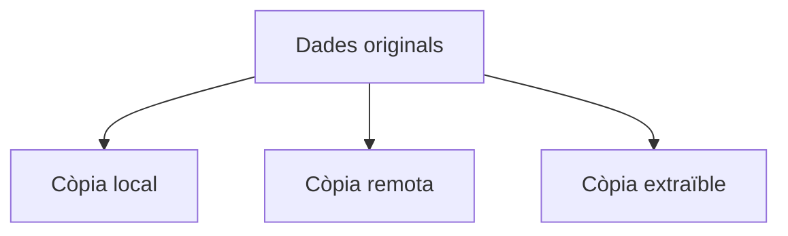

---
hide:
  - navigation
---
# 6. Retenció, rotació i mitjans

## Rotació de còpies

La rotació determina quines còpies es reutilitzen i quines es conserven. Un esquema senzill pot mantindre set còpies diàries, quatre setmanals i dotze mensuals.

El model **GFS** (*Grandfather–Father–Son*) associa:

- **Son:** còpies diàries;
- **Father:** còpies setmanals;
- **Grandfather:** còpies mensuals o d’arxiu.

La rotació ha d’estar relacionada amb la retenció i amb el risc de necessitar una versió antiga.

## Regla 3-2-1

La regla 3-2-1 recomana:

1. **Tres còpies** de la informació, inclosos els originals.
2. **Dos tipus de suport** diferents, com NAS i disc extern.
3. **Una còpia fora de la ubicació principal**, com un núvol, una altra seu o un servidor remot.



La còpia externa protegeix davant incendis, inundacions, robatoris i destrucció de l’equipament. Una còpia desconnectada o immutable també limita l’impacte d’un ransomware.

## Emmagatzematge remot

És el que es troba en una màquina o ubicació diferent de l’equip que genera les dades: servidor de còpies, NAS, SSH, centre de dades o servei de núvol.

**Avantatges:** separació física, automatització i accés centralitzat.

**Riscos:** dependència de xarxa, credencials compromeses, permisos incorrectes i ransomware amb accés al recurs compartit.

Per reduir riscos, separa els comptes de backup dels comptes d’ús diari, limita l’escriptura, xifra les transferències i prova la restauració.

## Emmagatzematge extraïble

Inclou memòries USB, HDD i SSD externs i targetes de memòria. Aporta portabilitat i permet mantindre còpies desconnectades, però està exposat a pèrdua, robatori, colps, degradació, malware i desconnexions incorrectes.

### Proteccions recomanades

- Xifrar el suport amb BitLocker, LUKS o VeraCrypt.
- Expulsar-lo correctament abans de desconnectar-lo.
- Etiquetar-lo sense revelar informació confidencial.
- Mantindre més d’una unitat i revisar-ne l’estat.
- Guardar-lo en una ubicació segura i separada.
- No considerar un únic disc extern com a única còpia.

## Integritat de les còpies

Una còpia pot existir però estar corrupta. Cal comprovar que els fitxers s’obrin, fer restauracions de prova, comparar mides i utilitzar hashes quan siga convenient.

```bash
sha256sum document.pdf
```

Si el contingut canvia, el valor SHA-256 canvia. El hash ajuda a comprovar la integritat, però no substitueix una còpia independent ni una prova de restauració.

## Checklist de verificació

- [ ] La còpia té data, origen i responsable.
- [ ] La destinació no és el mateix disc que les dades originals.
- [ ] Hi ha una còpia fora de la ubicació principal.
- [ ] El suport extraïble està xifrat.
- [ ] Els permisos del backup són independents.
- [ ] S’ha restaurat almenys un fitxer.
- [ ] S’ha registrat el resultat de la prova.

[Següent: còpies en Linux](07-copies-linux.md) · [Pàgina principal de la UP2](../ut2-emmagatzematge.md)
