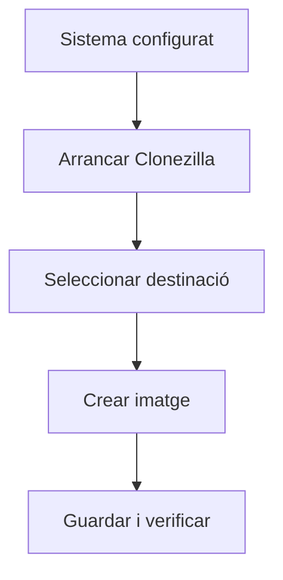
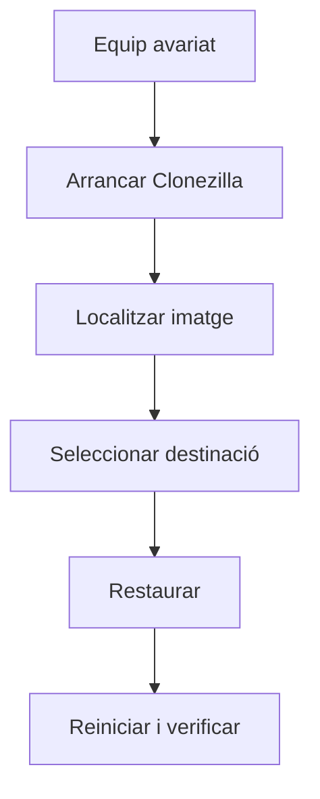

---
hide:
  - navigation
---
# 8. Imatges de sistema

## Què és una imatge?

Una **imatge de sistema** és una còpia del contingut d’un disc o partició que permet reconstruir un equip complet. Pot incloure sistema operatiu, aplicacions, configuració, usuaris, fitxers, particions i informació d’arrancada.

| Còpia de fitxers | Imatge |
| --- | --- |
| Copia documents concrets | Copia un sistema complet |
| Menys espai | Més espai |
| Restauració selectiva | Restauració global |
| Ideal per dades | Ideal per recuperar equips |

Si un usuari elimina un document, convé un backup de fitxers. Si falla completament el disc del sistema, una imatge pot reduir molt el temps de recuperació.

## Clonezilla

**Clonezilla** és una ferramenta lliure per crear i restaurar imatges de discos i particions. És útil per conservar un estat abans d’un canvi, recuperar un equip o desplegar equips amb una configuració semblant.

## Crear una imatge

Procediment general:

1. Prepara una màquina virtual i un segon disc o recurs de xarxa.
2. Arranca des de la ISO de Clonezilla.
3. Tria `device-image` i la ubicació, per exemple `local_dev`.
4. Selecciona `savedisk` per guardar un disc complet.
5. Assigna un nom descriptiu, com `ubuntu_smx_up2`.
6. Comprova dues vegades el disc origen i inicia el procés.
7. Verifica que la imatge existeix i registra la seua ubicació.

## Restaurar una imatge

Amb `device-image`, localitza la imatge, tria `restoredisk`, selecciona el disc de destinació i confirma només després de revisar-lo. La restauració sobreescriu el contingut actual del disc.

## Verificació

Després de restaurar:

- comprova que el sistema arranca;
- localitza els documents de l’estat original;
- comprova aplicacions i configuració;
- verifica que els canvis posteriors a la imatge han desaparegut;
- registra el temps necessari i qualsevol incidència.

## Estratègia completa

| Problema | Mesura adequada |
| --- | --- |
| Falla un disc | RAID o redundància |
| Eliminació accidental | Backup de fitxers |
| Ransomware | Còpia versionada i aïllada |
| Destrucció de la seu | Còpia externa |
| Fallada completa d’un PC | Imatge del sistema |

Les tècniques es complementen: cap d’elles resol tots els escenaris.

!!! warning "Restauració destructiva"
    Revisa sempre el disc de destinació. Practica amb màquines virtuals i no restaures una imatge sobre un equip real sense autorització i una còpia prèvia.

[Pàgina principal de la UP2](../ut2-emmagatzematge.md) · [Activitat 4: Clonezilla](activitats/activitat-4-clonezilla.md)
