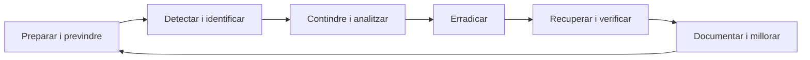

---
hide:
  - navigation
---
# UP3. Mecanismes de seguretat activa

Una empresa pot tindre els equips protegits físicament, contrasenyes robustes i còpies de seguretat i, tot i això, patir una infecció o una pèrdua d’informació. En aquesta unitat seguirem el cas d’**OfiCat**, una empresa de serveis administratius amb ordinadors Windows, un equip Ubuntu i documents compartits. Un treballador executa un instal·lador dubtós; després, l’equip funciona malament i alguns documents no apareixen. No donarem cap símptoma per prova: aprendrem a obtindre evidències i a actuar amb criteri.

La seguretat activa agrupa les mesures que redueixen la probabilitat d’un incident o que el detecten i el frenen. També estudiarem la resposta i la recuperació, perquè el treball complet del tècnic inclou tornar a posar el servei en condicions segures. Les fronteres amb la seguretat passiva i les còpies no són absolutes: la [UP1](ut1-seguretat-passiva.md) ens ajuda a protegir l’entorn i la [UP2](ut2-emmagatzematge.md) ens dona la base per a restaurar dades.

## Resultat d’aprenentatge i criteris

**RA3.** Aplica mecanismes de seguretat activa descrivint les seues característiques i relacionant-les amb les necessitats d’ús del sistema informàtic.

| Criteri | Text literal del criteri |
| --- | --- |
| **RA3.a** | S’han seguit plans de contingència per a actuar davant fallades de seguretat. |
| **RA3.b** | S’han classificat els principals tipus de programari maliciós. |
| **RA3.c** | S’han realitzat actualitzacions periòdiques dels sistemes per a corregir possibles vulnerabilitats. |
| **RA3.d** | S’ha verificat l’origen i l’autenticitat de les aplicacions que s’instal·len en els sistemes. |
| **RA3.e** | S’han instal·lat, provat i actualitzat aplicacions específiques per a la detecció i eliminació de programari maliciós. |
| **RA3.f** | S’han aplicat tècniques de recuperació de dades. |

## Itinerari

El cicle és una guia mental, no una recepta rígida. En un incident real algunes fases se solapen, es repeteixen o depenen d’una autorització.

| Bloc | CA | Què hi aprendràs |
| --- | --- | --- |
| [1. Amenaces i programari maliciós](ut3-seguretat-activa/01-amenaces-programari-malicios.md) | RA3.b | Classificar famílies de malware, vies d’entrada, indicis i defenses. |
| [2. Vulnerabilitats i actualització de sistemes](ut3-seguretat-activa/02-vulnerabilitats-actualitzacions.md) | RA3.c | Interpretar el risc, prioritzar pedaços i comprovar actualitzacions en Windows i Ubuntu. |
| [3. Verificació i instal·lació segura de programari](ut3-seguretat-activa/03-verificacio-programari.md) | RA3.d | Comprovar origen, hashes, signatures i cadena de confiança. |
| [4. Detecció i eliminació de programari maliciós](ut3-seguretat-activa/04-deteccio-eliminacio-malware.md) | RA3.e | Actualitzar, provar i interpretar eines de detecció, amb EICAR en laboratori. |
| [5. Plans de contingència i resposta a incidents](ut3-seguretat-activa/05-plans-contingencia-incidents.md) | RA3.a | Registrar, contindre, escalar i verificar la recuperació. |
| [6. Tècniques de recuperació de dades](ut3-seguretat-activa/06-recuperacio-dades.md) | RA3.f | Restaurar còpies i recuperar fitxers en suports virtuals de prova. |

## Abans de practicar

Tot el material és defensiu. No descarregues ni executes malware real, no desactives proteccions per a forçar una prova i no treballes amb dades personals. Les pràctiques de detecció es fan amb EICAR o fitxers de test; les de recuperació, amb discos virtuals secundaris o imatges preparades. Abans d’aïllar una màquina per a una descàrrega legítima, actualitza-la i prepara un snapshot; després, usa una xarxa de laboratori autoritzada.

Les comandes i pantalles poden canviar segons la versió i les polítiques del centre. Una demostració descrita aquí no és una afirmació que s’haja executat: els resultats d’exemple estan marcats com a il·lustratius.

[Començar la teoria](ut3-seguretat-activa/01-amenaces-programari-malicios.md) · [Tornar a Seguretat informàtica](index.md)
