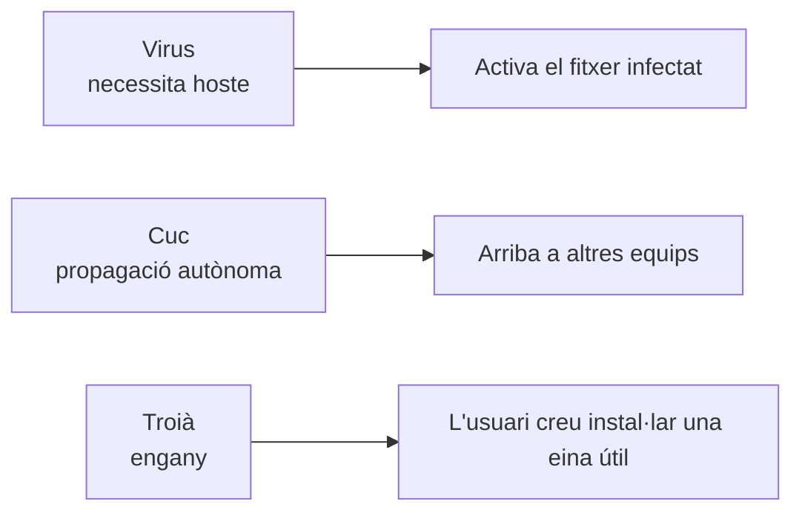
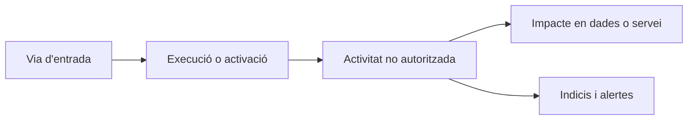

---
hide:
  - navigation
---
# 1. Amenaces i programari maliciós

**CA RA3.b:** S’han classificat els principals tipus de programari maliciós.

## Objectius

- Distingir malware d’una incidència tècnica ordinària.
- Classificar-lo per comportament, propagació i finalitat.
- Reconéixer vies d’entrada i indicadors de compromís (IOC).
- Relacionar cada amenaça amb una defensa adequada i les seues limitacions.

## El cas d’OfiCat

Un treballador instal·la un suposat visor PDF des d’un anunci. L’endemà, un equip va lent i dos documents no apareixen. Això és una **sospita**, no un diagnòstic. La lentitud també pot deure’s a falta de memòria, un disc degradat o una actualització. A la inversa, un equip compromés pot no mostrar cap símptoma evident. El tècnic registra els fets, conserva les alertes i investiga sense executar de nou el programa dubtós.

El programari maliciós (malware) és programari creat o utilitzat amb una finalitat perjudicial: robar informació, alterar el sistema, controlar-lo sense autorització o impedir l’accés a les dades. Pot afectar la tríada de la [UP1](../ut1/01-informacio-actiu.md): un spyware compromet la **confidencialitat**, un virus que modifica fitxers la **integritat** i un ransomware la **disponibilitat**. El terme *virus* no és sinònim de tot el malware.

## Famílies i categories

Les categories poden solapar-se. *Troià* descriu com arriba una amenaça; *ransomware*, què fa; *cuc*, com es propaga.

| Tipus | Funcionament conceptual | Defensa destacada |
| --- | --- | --- |
| **Virus** | S’associa a un fitxer hoste i es replica quan s’activa. | Fonts fiables, pedaços i antivirus. |
| **Cuc (worm)** | Es propaga automàticament entre equips vulnerables, sense necessitar un hoste tradicional. | Pedaços, segmentació i aïllament. |
| **Troià** | Es presenta com una aplicació útil o legítima però amaga una funció no autoritzada. | Origen, hash i signatura de l’editor. |
| **Ransomware** | Impedeix l’accés a dades o sistemes per a extorsionar; de vegades també sostrau informació. | Còpies aïllades, actualitzacions i resposta ràpida. |
| **Spyware** | Recull informació o activitat sense consentiment. | Permisos mínims, MFA i eines fiables. |
| **Keylogger** | Registra pulsacions; pot ser programari o dispositiu físic. | Protecció d’equips i revisió d’accessos. |
| **Rootkit** | Oculta activitat o dona persistència, sovint amb privilegis elevats. | Anàlisi externa i reinstal·lació quan no es pot garantir la integritat. |
| **Adware/PUA** | Mostra publicitat o incorpora comportaments no desitjats; no tota PUA és malware. | Revisar opcions de l’instal·lador i extensions. |
| **Backdoor** | Facilita un accés no autoritzat que evita els controls normals. | Inventari, pedaços i rotació de credencials. |
| **Bot** | Equip compromés controlat remotament; una botnet n’agrupa molts. | Aïllament i detecció de trànsit anòmal. |
| **Fileless** | Abusa de memòria o eines legítimes i deixa menys artefactes tradicionals en disc. | Registres, anàlisi de comportament i mínim privilegi. |

Un programa legítim d’administració remota no és malware per definició: importen l’autorització, l’ús i el context. Tampoc cal confondre **phishing**, que és una tècnica d’enginyeria social, amb un tipus de malware; pot conduir a descarregar-ne o executar-ne un.

### Com llegir les famílies

Un **virus** modifica o acompanya un fitxer hoste. Per exemple, un document amb macros malicioses podria activar una càrrega quan l’usuari l’obri. La prevenció combina formats protegits, permisos limitats, actualitzacions i anàlisi abans d’obrir. Un **cuc** busca altres equips o serveis vulnerables i pot fer créixer l’incident ràpidament; per això els pedaços, la segmentació i l’aïllament són especialment importants.

El **troià** depén de l’engany: un instal·lador que promet una actualització però afegeix una funció d’accés remot és un exemple conceptual. El control principal és verificar la font, el hash i la signatura abans d’executar. El **ransomware** prioritza l’impacte en disponibilitat, però pot combinar xifrat amb robatori de dades. Les còpies aïllades ajuden a recuperar, però no eviten que calga investigar l’accés i les credencials.

El **spyware** i el **keylogger** busquen informació d’ús, credencials o comunicacions. El mínim privilegi, l’autenticació multifactor i la revisió d’accessos redueixen l’impacte, però no autoritzen a inspeccionar converses privades fora del procediment. Un **rootkit** pot ocultar processos o fitxers i fer que les eines locals siguen poc fiables; quan no podem garantir la integritat, una anàlisi des d’un mitjà fiable o una reinstal·lació és més prudent.

L’**adware** pot ser una aplicació legítima amb publicitat o una PUA agressiva; la classificació depén del consentiment, el comportament i la política. Una **backdoor** és un accés que evita el control normal, mentre que un **bot** és l’equip ja controlat que rep ordres remotes. En tots dos casos cal revisar comptes, serveis i connexions, no només esborrar un executable.

El **fileless malware** pot abusar de processos i eines legítimes, com scripts o intèrprets, en lloc de deixar un executable evident. «Fileless» no vol dir «sense rastre»: registres, memòria, línies d’ordres i connexions poden aportar indicis. La resposta ha de ser autoritzada i proporcional; no s’han de convertir aquestes explicacions en receptes d’evasió.

### Tres comparacions útils

La imatge és conceptual: no descriu passos d’explotació. Un ransomware pot arribar com a troià i propagar-se amb característiques de cuc. WannaCry (2017) és un cas històric de ransomware amb propagació automatitzada; Stuxnet, descobert el 2010, va mostrar com un programari podia orientar-se al sabotatge industrial; Emotet va evolucionar d’una amenaça bancària a una plataforma de distribució. Són exemples per entendre combinacions i impactes, no receptes operatives.

## Vies d’entrada i indicadors

Les vies habituals són instal·ladors manipulats o piratejats, adjunts i enllaços fraudulents, aplicacions sense pedaços, dispositius extraïbles, extensions del navegador, credencials compromeses i dependències o actualitzacions de tercers. Un **indicador de compromís (IOC)** és una dada que orienta una investigació: un hash associat a una mostra coneguda, un fitxer inesperat, una alerta o una connexió identificada. Un IOC és una pista, no una prova completa; la seua absència tampoc garanteix que l’equip estiga net.

## Exemple resolt

| Avís d’OfiCat | Hipòtesi inicial | Què falta comprovar |
| --- | --- | --- |
| Extensions desconegudes i nota d’extorsió | Ransomware possible | Abast, còpies i possible exposició. |
| Falsa actualització del visor PDF | Troià possible | Font, editor, hash i registres. |
| Diversos equips fallen alhora | Cuc o causa compartida | Si hi ha propagació autònoma. |
| Lentitud després d’una actualització oficial | No hi ha prova de malware | Recursos, errors, versió i alertes. |

La classificació correcta és la que justifica la hipòtesi amb dades disponibles i diu què cal verificar.

!!! warning "Laboratori segur"
    No uses mostres reals. Per a provar el flux de detecció, EICAR és un fitxer de test que no és malware ni s’ha d’executar. Si el sistema el bloqueja, el bloqueig és un resultat vàlid.

## Errors habituals

- Dir «virus» a qualsevol malware.
- Donar per segura una aplicació perquè té una icona coneguda.
- Pensar que Linux o una xarxa interna no poden ser afectats.
- Confondre lentitud amb prova concloent d’infecció.
- Eliminar una alerta sense registrar-la ni valorar l’abast.

## Resum

El malware es classifica des de diversos eixos i les etiquetes es poden combinar. El diagnòstic necessita evidències. Les defenses es complementen: origen fiable, pedaços, mínim privilegi, còpies, detecció i resposta.

## Autoavaluació

1. Quina diferència hi ha entre virus i cuc?
2. Pot un troià ser ransomware?
3. Per què l’absència d’alertes no prova que un equip estiga net?
4. Quins pilars de la CIA pot afectar un ransomware?

??? note "Respostes"
    1. El virus necessita un fitxer hoste; el cuc pot propagar-se autònomament.
    2. Sí: una etiqueta descriu la via o presentació i l’altra la finalitat.
    3. Les eines tenen cobertura i falsos negatius; només indiquen el que han observat.
    4. Sobretot disponibilitat i integritat, i possiblement confidencialitat si hi ha robatori.

## Fonts i ampliació

- [INCIBE-CERT](https://www.incibe.es/incibe-cert), avisos i guies defensives.
- [CISA](https://www.cisa.gov/), recursos sobre amenaces i resposta.
- [NIST SP 800-61 Rev. 3](https://csrc.nist.gov/pubs/sp/800/61/r3/final), resposta a incidents.

[Següent: vulnerabilitats i actualitzacions](02-vulnerabilitats-actualitzacions.md) · [Índex de la UP3](index.md)
