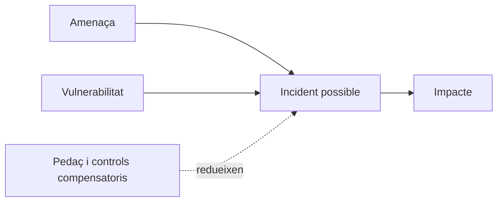

---
hide:
  - navigation
---
# 2. Vulnerabilitats i actualització de sistemes

**CA RA3.c:** S’han realitzat actualitzacions periòdiques dels sistemes per a corregir possibles vulnerabilitats.

## Objectius

- Diferenciar amenaça, vulnerabilitat, exploit, impacte i risc.
- Interpretar un identificador CVE i una puntuació CVSS sense confondre’ls.
- Planificar, aplicar i verificar pedaços en un entorn Windows i Ubuntu.
- Acreditar la periodicitat amb inventari i registres.

## El cas d’OfiCat

L’inventari d’OfiCat mostra un navegador sense actualitzar en un portàtil que consulta documents de clients. La vulnerabilitat és una debilitat del programari; l’amenaça és una circumstància o agent que podria aprofitar-la; el risc depén de la probabilitat i de l’impacte. Un *exploit* és el mecanisme d’aprofitament, però estudiar-lo no és necessari per a aplicar una defensa.



Un pedaç és una modificació que corregeix un problema. No totes les actualitzacions són de seguretat i no totes exigeixen canviar de versió principal. Si encara no hi ha pedaç, podem reduir l’exposició, limitar permisos, desactivar temporalment una funció de risc o segmentar el servei segons el pla.

## CVE, CVSS i avisos

**CVE** identifica una vulnerabilitat divulgada amb un format com `CVE-any-número`. **CVSS** expressa la gravetat tècnica en una escala de 0 a 10, amb una versió i un vector de mètriques. La puntuació base no és el risc de la nostra empresa: cal afegir exposició, actius afectats, controls i impacte.

| CVSS habitual | Interpretació |
| ---: | --- |
| 0 | Cap |
| 0,1–3,9 | Baixa |
| 4,0–6,9 | Mitjana |
| 7,0–8,9 | Alta |
| 9,0–10 | Crítica |

Una vulnerabilitat **zero-day** és una debilitat desconeguda per qui l’ha de corregir o per a la qual no hi ha hagut temps de resposta quan s’explota. No significa simplement «CVSS 10».

Quan lliges un avís, busca producte i versions afectades, gravetat, versió corregida, mitigacions, data i si hi ha explotació observada. Consulta fonts com [CVE Program](https://www.cve.org/), [NVD](https://nvd.nist.gov/), [MSRC](https://msrc.microsoft.com/update-guide) i [Ubuntu Security Notices](https://ubuntu.com/security/notices). En Ubuntu, una versió pot incorporar un *backport*: la correcció arriba a una versió anterior mantenint el número de funcionalitat. No deduïsques l’estat només comparant números amb el projecte original.

### Prioritzar amb context

Un servidor exposat a Internet amb una CVSS alta pot tindre prioritat immediata. Un equip aïllat amb una CVSS crítica també és important, però pot tindre una exposició menor. Aquest és un exemple didàctic fictici: la decisió necessita inventari, ús, dades, compensacions i disponibilitat de proves, no només ordenar puntuacions.

## Política d’actualitzacions

Una política defineix qui actualitza, quins sistemes entren en l’abast, com es prova, quan es reinicia i com es documenta. La seqüència recomanada és:

1. Inventariar equips, versions, propietaris i serveis.
2. Revisar avisos oficials i prioritzar per exposició i impacte.
3. Fer snapshot o còpia del laboratori i provar.
4. Instal·lar el pedaç i reiniciar si és necessari.
5. Comprovar arrencada, servei i aplicació de prova.
6. Registrar versions abans/després i programar la revisió següent.

Les actualitzacions automàtiques redueixen oblits però no substitueixen la verificació. Un sistema sense suport (EOL) pot deixar de rebre pedaços; cal migrar-lo o aplicar controls temporals. Les actualitzacions del sistema, aplicacions, firmware i signatures antimalware tenen canals diferents. Un snapshot de VM tampoc és una còpia independent.

## Demostració en Windows 11

En una VM autoritzada, obri **Configuració > Windows Update**, comprova l’estat, busca actualitzacions, revisa l’historial i reinicia només quan el pla ho permeta. Amb `winver` pots identificar la versió. Després comprova que l’equip arranca i que l’aplicació de prova funciona. No instal·les indiscriminadament controladors o actualitzacions opcionals, i recorda que Windows Update no actualitza necessàriament totes les aplicacions de tercers.

## Demostració en Ubuntu LTS

```bash
cat /etc/os-release
uname -r
sudo apt update
apt list --upgradable
sudo apt upgrade
```

`/etc/os-release` i `uname -r` mostren distribució i nucli actiu. `apt update` refresca els índexs: **no instal·la** pedaços. `apt list --upgradable` mostra candidats i `apt upgrade` aplica canvis segons les dependències; llig el resum abans de confirmar i no uses `-y` en la primera demostració.

Per revisar actualitzacions automàtiques, només si el paquet existeix:

```bash
systemctl list-timers 'apt-daily*' --all
apt policy unattended-upgrades
sudo unattended-upgrade --dry-run
```

La simulació no instal·la actualitzacions, però pot tardar. Consulta, sense editar polítiques del centre, `/etc/apt/apt.conf.d/20auto-upgrades` quan existisca i `/var/log/apt/history.log`. Snap, Flatpak i aplicacions instal·lades per altres mecanismes tenen canals propis.

## Registre i periodicitat

| Data | Equip | Abans → després | Actualitzacions | Reinici | Comprovació | Pròxima revisió |
| --- | --- | --- | --- | --- | --- | --- |
| Dilluns fictici | OFI-W11-02 | 23H2 → actualitzat | Sistema i navegador | Sí | Arrencada i visor PDF | Divendres |
| Divendres fictici | OFI-W11-02 | Sense pendents | Revisió repetida | No | Historial correcte | Dilluns següent |

El valor del registre és demostrar que hi ha dates diferents, comprovació del resultat i una nova revisió, no marcar una casella una sola vegada.

### Quan una actualització falla

Si la instal·lació dona error, no la dones per feta. Conserva el missatge, comprova si el servei ha quedat en funcionament, revisa l’espai lliure i les dependències i comunica-ho al responsable. En un laboratori pots tornar al snapshot previst; en un equip real cal seguir el procediment de canvi i no restaurar una còpia antiga sense valorar què es perdria. Un reinici pendent és una dada important del registre, no un detall estètic.

La periodicitat tampoc significa aplicar qualsevol actualització immediatament sense control. Una organització pot definir una revisió diària d’avisos, una finestra de proves i un termini de desplegament segons la prioritat. Els equips exposats, els que tracten dades sensibles i els que tenen vulnerabilitats explotades reben una atenció diferent d’un ordinador de laboratori aïllat. La decisió ha de quedar justificada.

Per a OfiCat, un registre mínim relaciona inventari, avís, versió afectada, pedaç candidat, prova funcional, resultat i responsable. Això permet contestar preguntes professionals: quins equips continuen pendents?, quin risc queda obert?, quan es revisarà de nou? Sense aquesta traçabilitat, «actualitzat» és només una suposició.

## Errors habituals i resum

No confongues `apt update` amb instal·lar, CVE amb CVSS, antivirus amb pedaç, ni reinici pendent amb actualització completada. Actualitzar és un procés: inventariar, prioritzar, aplicar, verificar i registrar.

## Autoavaluació

1. Què diferencia una amenaça d’una vulnerabilitat?
2. Què identifica una CVE?
3. Què fa `apt update`?
4. Com demostraries que les actualitzacions són periòdiques?

??? note "Respostes"
    1. L’amenaça és l’agent o circumstància; la vulnerabilitat és la debilitat.
    2. La identitat estandarditzada d’una vulnerabilitat divulgada.
    3. Actualitza els índexs de paquets; no instal·la el pedaç.
    4. Amb registres en dates diferents, versions abans/després i comprovacions.

## Fonts i ampliació

- [CVE Program](https://www.cve.org/) i [NVD](https://nvd.nist.gov/).
- [FIRST: CVSS 4.0](https://www.first.org/cvss/v4.0/).
- [Actualitzacions de seguretat d’Ubuntu](https://documentation.ubuntu.com/security/security-updates/) i [USN](https://ubuntu.com/security/notices).
- [Windows Update Security](https://learn.microsoft.com/en-us/windows/deployment/update/windows-update-security) i [MSRC](https://msrc.microsoft.com/update-guide).

[Següent: verificació de programari](03-verificacio-programari.md) · [Índex de la UP3](index.md)
