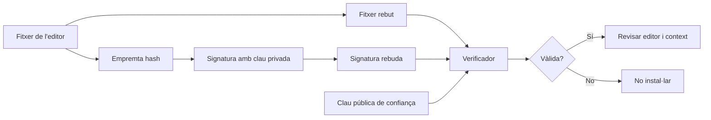

---
hide:
  - navigation
---
# 3. Verificació i instal·lació segura de programari

**CA RA3.d:** S’ha verificat l’origen i l’autenticitat de les aplicacions que s’instal·len en els sistemes.

## Objectius

- Triar canals de distribució fiables.
- Diferenciar origen, integritat, autenticitat i reputació.
- Calcular i comparar una empremta SHA-256.
- Interpretar una signatura digital i decidir si instal·lar.

## El cas d’OfiCat

Dos fitxers es diuen `visor.pdf.exe` i tenen la mateixa icona. Un prové de la web oficial del fabricant; l’altre, d’un anunci. El nom, la icona i el cadenat HTTPS no són suficients. **Origen** és d’on prové el fitxer; **integritat**, si coincideix amb una referència; **autenticitat**, si podem vincular-lo a l’editor; **reputació**, què indiquen fonts i historial. Cap comprovació aïllada certifica que el programa siga innocu.

Preferim web oficial, repositori autenticat o botiga gestionada. Evitem anuncis de descàrrega, dominis imitadors, instal·ladors modificats i programari piratejat. HTTPS protegeix el canal amb el domini, però un domini fraudulent també pot usar HTTPS.

## Hash SHA-256

Una funció hash transforma el contingut en una empremta de longitud fixa. El mateix contingut produeix el mateix valor; un canvi mínim sol produir-ne un de molt diferent. No és xifrat i no permet recuperar el fitxer original. MD5 i SHA-1 no són adequats per a una verificació resistent a col·lisions; en aquesta unitat usem SHA-256.

Un hash només prova coincidència amb el valor de referència. Si un atacant pot modificar el fitxer i també publicar una suma falsa al mateix lloc, la comparació no resol l’origen. Obté la suma d’una font de confiança i, quan siga possible, valida també la signatura de la llista de sumes.

### Demostració innocent en Ubuntu

```bash
mkdir -p ~/laboratori-hash
cd ~/laboratori-hash
printf 'Document de prova\n' > original.txt
cp original.txt copia.txt
sha256sum original.txt copia.txt
printf 'Canvi de contingut\n' >> copia.txt
sha256sum original.txt copia.txt
```

Abans del canvi les empremtes coincideixen; després, no. És un exemple de laboratori, no una suma oficial. Amb una llista de sumes amb el format correcte pots usar `sha256sum -c`; compara sempre el fitxer i la font esperada.

En PowerShell:

```powershell
Get-FileHash -Path .\original.txt -Algorithm SHA256
Get-FileHash -Path .\copia.txt -Algorithm SHA256
```

Compara el valor complet amb la referència oficial. Majúscules i minúscules hexadecimals són equivalents; un sol caràcter diferent no ho és.

## Signatura digital i cadena de confiança

L’editor firma una empremta amb la clau privada. El verificador usa la clau pública associada i comprova que el contingut no ha canviat. La identitat de la clau s’ha de validar per una cadena de certificats o per un canal fiable. Signar no és xifrar el fitxer sencer: acredita contingut signat i vinculació amb una clau, però no garanteix absència d’errors o intencions malicioses.



En Windows, a les propietats de l’instal·lador, revisa la pestanya de signatures digitals quan existisca: signant, estat i editor. En una VM autoritzada, PowerShell pot mostrar:

```powershell
Get-AuthenticodeSignature -FilePath .\instal·lador.exe |
  Format-List Status, StatusMessage, SignerCertificate
```

`Valid` no implica innocuïtat; una signatura absent tampoc implica automàticament malware. En Ubuntu, APT valida metadades signades del repositori i els hashes dels paquets dins de la cadena. Un `.deb` descarregat manualment no té necessàriament la mateixa protecció.

Per a una ISO, la cadena correcta és obtenir la ISO, `SHA256SUMS`, `SHA256SUMS.gpg` i la clau oficial; verificar la identitat de la clau, la signatura de les sumes i després la suma de la ISO. Segueix el [tutorial oficial d’Ubuntu](https://ubuntu.com/tutorials/how-to-verify-ubuntu); no uses receptes antigues com `apt-key` ni desactives verificacions.

## Reputació i cadena de subministrament

Un atac de cadena de subministrament compromet producció o distribució, de manera que una font habitual també pot patir un incident. La confiança del proveïdor, signatures, actualitzacions i monitoratge es complementen. [VirusTotal](https://www.virustotal.com/) pot ajudar a consultar el hash, però no és un veredicte: zero deteccions no garanteix seguretat i no s’han de pujar nòmines, documents interns o dades personals.

## Decisió d’instal·lació

| Situació | Decisió raonada |
| --- | --- |
| Font oficial, hash coincident i editor esperat | Instal·lació possible segons política i necessitat. |
| Hash diferent | No instal·lar; tornar a la font oficial i investigar. |
| Signatura invàlida o editor inesperat | No instal·lar i escalar. |
| Font desconeguda sense deteccions | No confiar només en l’antivirus. |

En el cas d’OfiCat, només es considera el primer instal·lador: font oficial, empremta publicada correcta i signant esperat. El segon no s’executa; es registra origen, versió, hash, signatura i decisió.

### Procediment breu abans d’instal·lar

Primer defineix la necessitat: quin problema resol l’aplicació i qui l’ha autoritzada? Després identifica l’editor i arriba al canal oficial escrivint el domini o usant el repositori configurat, no un anunci. Anota versió i data, baixa el fitxer en una carpeta de treball, compara l’empremta i revisa la signatura quan existisca. Si una comprovació falla, conserva el fitxer sense executar-lo, torna a una font coneguda i escala el cas.

Finalment, comprova permisos i components que l’instal·lador vol afegir. Una eina gratuïta pot oferir extensions, serveis d’inici o telemetria que no són necessaris per a la funció principal. En una organització, la política pot exigir prova en una VM, compte sense privilegis, registre del programari i una via de desinstal·lació. La reputació complementa aquestes decisions, però no les substitueix.

### Què no prova cada comprovació?

Un hash coincident no diu si l’editor ha publicat un programa amb errors. Una signatura vàlida no diu si l’editor ha patit un compromís ni si l’aplicació demana més permisos dels necessaris. Una detecció zero en un servei de reputació no cobreix mostres noves, i una alerta individual pot ser un fals positiu. La confiança es construeix combinant controls i coneixent-ne el límit.

Per això el registre d’OfiCat inclou també la necessitat, l’editor, la versió, el canal, el hash, l’estat de la signatura, els permisos sol·licitats, la persona que autoritza i el resultat de la prova. Si en el futur apareix una vulnerabilitat, aquest inventari permet saber quins equips tenen aquella versió i quina actualització cal revisar.

## Errors habituals i resum

HTTPS no certifica el programa; un hash no identifica l’editor; un hash publicat al mateix lloc dubtós pot ser insuficient; VirusTotal no és una garantia. La instal·lació segura és una decisió documentada basada en origen, integritat, autenticitat, necessitat i política.

## Autoavaluació

1. Per què un hash correcte no acredita l’editor?
2. Què comprova una signatura vàlida?
3. Què fas si SHA-256 no coincideix?
4. És segur pujar una nòmina a VirusTotal?

??? note "Respostes"
    1. No vincula el contingut a una identitat de confiança.
    2. El contingut signat i la vinculació amb una clau, que encara cal validar.
    3. No instal·les i tornes a obtenir el fitxer de la font autoritzada.
    4. No; pot exposar informació privada a tercers.

## Fonts i ampliació

- [Integritat de programari i imatges d’Ubuntu](https://documentation.ubuntu.com/security/software-integrity/image-verification/).
- [Tutorial oficial per verificar Ubuntu](https://ubuntu.com/tutorials/how-to-verify-ubuntu).
- [Get-AuthenticodeSignature](https://learn.microsoft.com/en-us/powershell/module/microsoft.powershell.security/get-authenticodesignature).
- [VirusTotal](https://www.virustotal.com/), només per a consultes compatibles amb la política de privacitat.

[Següent: detecció i eliminació](04-deteccio-eliminacio-malware.md) · [Portada de la UP3](../ut3-seguretat-activa.md)
