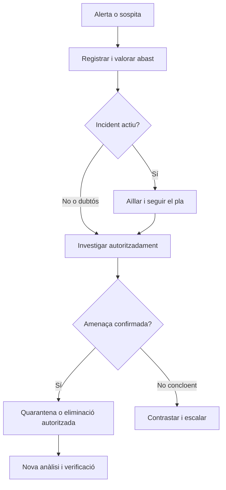

---
hide:
  - navigation
---
# 4. Detecció i eliminació de programari maliciós

**CA RA3.e:** S’han instal·lat, provat i actualitzat aplicacions específiques per a la detecció i eliminació de programari maliciós.

## Objectius

- Comprendre signatures, heurística, comportament i reputació.
- Diferenciar protecció en temps real, anàlisi sota demanda i EDR.
- Instal·lar, actualitzar i provar ClamAV en una VM Ubuntu.
- Interpretar una alerta, preservar evidències i verificar l’acció.

## El cas d’OfiCat

Defender alerta sobre un fitxer de Descàrregues. El tècnic no el torna a obrir ni l’elimina automàticament: registra ubicació, hora, nom de la detecció i acció aplicada, i consulta el pla. Si el fitxer s’ha executat amb privilegis, eliminar-lo no demostra que el sistema estiga íntegre. Cal valorar l’abast, aïllar si correspon i escalar.

## Com detecta una amenaça un antivirus?

| Mecanisme | Observa | Avantatge | Limitació |
| --- | --- | --- | --- |
| Signatures de detecció | Patrons o regles conegudes | Ràpid contra amenaces conegudes | Pot no veure variants noves. |
| Heurística | Característiques sospitoses | Pot detectar mostres desconegudes | Falsos positius. |
| Comportament | Accions de fitxers i processos | Detecta activitat anòmala | Necessita context i telemetria. |
| Reputació | Origen i historial | Ajuda amb fitxers desconeguts | Depén de les dades disponibles. |
| Sandbox | Comportament en un entorn controlat | Redueix exposició directa | No garanteix detecció total. |

La signatura de detecció no és la signatura digital de l’editor. La primera busca un patró d’amenaça; la segona comprova contingut i identitat. Actualitzar el motor i actualitzar la base de detecció són tasques relacionades però diferents.

Un **fals positiu** marca un fitxer legítim com a amenaça; un **fals negatiu** no detecta una amenaça. Un resultat sense deteccions només diu que l’eina no ha trobat res en aquella anàlisi.

## Accions de resposta

- **Bloqueig:** impedeix l’acció potencialment perillosa.
- **Quarantena:** separa el fitxer de manera que no s’utilitze normalment i permet revisar-lo.
- **Eliminació:** suprimeix el fitxer, però pot destruir evidència o un fitxer legítim.
- **Desinfecció:** intenta llevar el component maliciós quan és viable.
- **Reinstal·lació fiable:** pot ser preferible després d’un compromís greu si no es pot garantir la integritat.



## Microsoft Defender en Windows 11

En **Seguretat de Windows > Protecció contra virus i amenaces**, comprova protecció en temps real, data de la intel·ligència de seguretat, opcions d’anàlisi i historial. En un equip gestionat algunes opcions poden estar controlades; no canvies la política del centre.

Demostració guiada en VM: actualitza la intel·ligència, fes una anàlisi ràpida, analitza una carpeta de prova, llig una alerta de test si n’hi ha i comprova l’estat final. No instal·les dos antivirus residents alhora.

```powershell
Get-MpComputerStatus | Select-Object AntivirusEnabled, RealTimeProtectionEnabled, AntivirusSignatureLastUpdated
Update-MpSignature
Start-MpScan -ScanType QuickScan
```

Aquestes ordres poden fallar si el servei no està actiu o hi ha una política de gestió. No forces la configuració.

## ClamAV en Ubuntu

ClamAV és un motor lliure d’anàlisi, no un substitut complet d’una suite d’endpoint. `clamscan` fa anàlisi sota demanda i `freshclam` actualitza signatures; sovint el servei `clamav-freshclam` gestiona les actualitzacions.

```bash
sudo apt update
sudo apt install clamav clamav-freshclam
clamscan --version
systemctl status clamav-freshclam --no-pager
sudo journalctl -u clamav-freshclam -n 25 --no-pager
```

La primera ordre refresca índexs i la segona instal·la. La versió i els registres ajuden a comprovar l’estat. No executes dos actualitzadors alhora ni elimines fitxers de bloqueig si hi ha un error. La documentació de ClamAV recomana preparar les signatures abans d’usar el dimoni.

Per a una carpeta innòcua:

```bash
mkdir -p ~/laboratori-antivirus/mostres
printf 'Fitxer de control innocu\n' > ~/laboratori-antivirus/mostres/control.txt
clamscan -r ~/laboratori-antivirus/mostres
```

`-r` recorre subdirectoris. En `clamscan`, el codi d’eixida 0 indica cap detecció, 1 indica deteccions i 2 indica errors. Una anàlisi amb errors no és una anàlisi completada correctament. Evita analitzar tot el sistema en una classe curta.

## Prova segura amb EICAR

[EICAR](https://www.eicar.org/download-anti-malware-testfile/) és un fitxer de test dissenyat per activar deteccions sense malware real. No s’executa. Usa’l només dins d’una VM de prova, sense desactivar proteccions; si Defender el bloqueja abans de guardar-lo, registra el bloqueig com a resultat vàlid. També pots usar fitxers de test de la distribució si el professor els proporciona.

1. Registra l’estat de signatures.
2. Analitza la carpeta amb `control.txt`.
3. Incorpora EICAR només si el sistema ho permet normalment.
4. Analitza de nou i registra l’alerta o el bloqueig.
5. Després de documentar, elimina només el fitxer de test o mou-lo a un directori de prova; no uses `--remove` en carpetes generals.
6. Repeteix l’anàlisi i comprova que el fitxer de control es conserva.

Resultats **il·lustratius**, no captures inventades:

```text
control.txt: OK
fitxer de test: [nom de la signatura] FOUND
```

El nom exacte depén de la versió. La detecció valida el flux, no l’eficàcia contra tot el malware.

## Eines complementàries i evidència

Process Explorer i Autoruns, de Sysinternals, poden ajudar a observar processos i elements d’inici. No són antivirus: un procés desconegut no s’elimina només pel nom, perquè podria ser legítim o estar signat per un proveïdor. Un EDR amplia aquesta observació amb telemetria, correlació i resposta centralitzada; en aquesta unitat només en necessitem la idea.

Quan una eina detecta un fitxer, registra el nom de la detecció, la ruta, l’hora, l’equip, la versió del motor, la data de signatures i l’acció aplicada. No envies documents interns a un servei d’anàlisi extern. Si cal una segona opinió, usa el hash o un fitxer de laboratori i segueix la política de privacitat. En un incident real, conservar evidència pot ser més important que obtenir una carpeta aparentment neta.

Després de la contenció, revisa si s’han creat comptes, tasques programades, extensions o connexions inesperades, sempre amb eines i autorització adequades. Si no pots garantir la integritat, documenta la limitació i considera una reinstal·lació fiable. La neteja d’un únic fitxer no desfà necessàriament canvis ja aplicats al sistema.

## Errors habituals i resum

No confongues antivirus amb pedaços, detecció amb desinfecció, motor amb signatures o una anàlisi neta amb seguretat absoluta. Registra, preserva, actua segons el pla i torna a analitzar.

## Autoavaluació

1. Quina diferència hi ha entre signatura de detecció i signatura digital?
2. Què és un fals negatiu?
3. Per què fem una segona anàlisi?
4. EICAR és un virus?
5. Quina eina actualitza la base de ClamAV?

??? note "Respostes"
    1. La primera identifica patrons d’amenaça; la segona verifica contingut i identitat de l’editor.
    2. Una amenaça que l’eina no ha detectat.
    3. Per comprovar l’acció i l’estat de la carpeta, sense garantir absència total.
    4. No, és un fitxer de prova.
    5. `freshclam`, directament o mitjançant el servei.

## Fonts i ampliació

- [EICAR: fitxer de test](https://www.eicar.org/download-anti-malware-testfile/).
- [ClamAV: instal·lació](https://docs.clamav.net/manual/Installing/Packages.html), [signatures](https://docs.clamav.net/manual/Usage/SignatureManagement.html) i [anàlisi](https://docs.clamav.net/manual/Usage/Scanning.html).
- [Microsoft Defender: actualitzacions](https://learn.microsoft.com/en-us/defender-endpoint/microsoft-defender-antivirus-updates) i [historial de protecció](https://support.microsoft.com/en-us/windows/security/windows-security/protection-history-in-the-windows-security-app).
- [Microsoft Sysinternals](https://learn.microsoft.com/en-us/sysinternals/), per a observació, no com a antivirus.

[Següent: plans de contingència](05-plans-contingencia-incidents.md) · [Portada de la UP3](../ut3-seguretat-activa.md)
