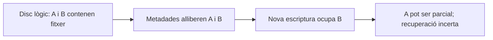
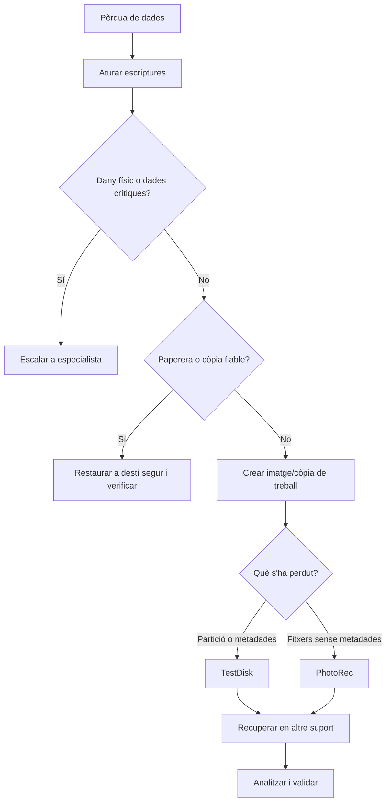

---
hide:
  - navigation
---
# 6. Tècniques de recuperació de dades

**CA RA3.f:** S’han aplicat tècniques de recuperació de dades.

## Objectius

- Explicar què ocorre quan s’elimina un fitxer.
- Diferenciar restaurar una còpia de recuperar des del suport afectat.
- Triar una tècnica sense modificar l’original.
- Utilitzar TestDisk i PhotoRec en discos virtuals de prova i validar el resultat.

## El cas d’OfiCat

Un usuari no troba uns documents. Primer es consulta paperera i còpies de la [UP2](../ut2/05-copies-seguretat.md); només si no són suficients s’investiga el suport. Si l’incident fora ransomware, recuperar un fitxer eliminat no equival a desxifrar un fitxer xifrat. La prioritat és deixar d’escriure, protegir l’original i recuperar en un altre destí.

## Què passa en eliminar?

El sistema de fitxers conserva noms, directoris, ubicacions i espai lliure. En eliminar, pot marcar els blocs com reutilitzables sense esborrar immediatament tots els bytes. Una nova escriptura pot sobreescriure’ls. La paperera només cobreix determinats mètodes i ubicacions; formatar tampoc implica sempre esborrat segur. La recuperació no està garantida.



És una simplificació: els sistemes de fitxers i suports reals tenen comportaments més complexos.

## HDD, SSD i disc virtual

| Suport | Implicació |
| --- | --- |
| **HDD** | Les dades poden persistir mentre no es reutilitza l’espai; deixar d’escriure és essencial. |
| **SSD** | TRIM i gestió interna poden fer la recuperació molt difícil, fins i tot sense escriptures visibles. |
| **Disc virtual** | És controlable per al laboratori, però no permet extrapolar l’èxit a un disc real. |

Si hi ha sorolls, fallades greus o dades insubstituïbles, evita intents repetits i escala a un especialista.

## Selecció de tècnica



La restauració d’una còpia anterior a l’incident és habitualment preferible. Una imatge de disc permet treballar sense modificar el suport original; un VDI no és necessàriament una imatge RAW que totes les eines puguen llegir. No uses ordres destructives sobre `/dev/sda` ni cap dispositiu no identificat.

## TestDisk i PhotoRec

**TestDisk** treballa amb particions i estructures del sistema de fitxers i pot conservar noms quan les metadades són recuperables. **PhotoRec** fa *file carving*: busca signatures internes i pot recuperar documents o fotografies sense la jerarquia original. Pot generar noms nous, fitxers incomplets o duplicats.

| Situació | Eina inicial | Expectativa |
| --- | --- | --- |
| Partició desapareguda | TestDisk | Localitzar-la i llistar fitxers si l’estructura ho permet. |
| Fitxer eliminat amb metadades | TestDisk | Possibles noms i estructura. |
| Metadades deteriorades | PhotoRec/QPhotoRec | Fitxers per signatures, sovint amb noms nous. |
| Avaria física greu | Especialista | No insistir ni escriure. |

## Demostració segura

El professor prepara una VM amb un disc de sistema, un disc secundari diferenciable o una imatge RAW, i un altre destí. Els fitxers són ficticis. Es conserva una còpia intacta i es treballa sobre una còpia descartable. Abans de manipular res:

```bash
sudo apt update
sudo apt install testdisk
lsblk -o NAME,SIZE,TYPE,FSTYPE,MOUNTPOINTS,MODEL
```

`lsblk` serveix per comparar capacitat, model, tipus i muntatge. No copies un identificador d’exemple: identifica el suport real. Si s’ha de desmuntar, només es desmunta el volum de prova autoritzat. El destí ha de ser un suport diferent.

### PhotoRec

Sobre una còpia d’una imatge RAW preparada, inicia `photorec disc-prova.img`, selecciona la imatge i àrea de prova, limita tipus com JPEG o PDF quan convinga i tria un directori de destí d’un altre suport. PhotoRec crea directoris `recup_dir.*`. No òbrigues automàticament els documents: verifica que són els esperats, analitza’ls amb una eina actualitzada i comprova contingut o hash quan hi haja una referència.

### TestDisk

En una còpia descartable, inicia `testdisk disc-particio.img`, selecciona el tipus de taula, entra a `Analyse` i `Quick Search`, i llista fitxers abans de considerar cap canvi. No uses `Write` sobre l’original ni sobre un disc real. Per al material inicial és suficient localitzar i copiar fitxers de manera segura.

### Restaurar no és el mateix que recuperar

Restaurar una còpia torna a posar una versió coneguda en un destí nou o en un sistema preparat. Normalment conserva noms, carpetes i permisos, i és la primera opció quan la còpia és anterior a l’incident i compleix l’RPO. Recuperar des del suport afectat intenta reconstruir informació que ja no apareix com a fitxer accessible; pot perdre noms, jerarquia o parts del contingut. Són processos diferents i no s’han de barrejar.

Després de recuperar, comprova que el fitxer s’obri completament, que la mida és coherent, que no té contingut inesperat i que passa una anàlisi actualitzada. Si tens un hash de referència, compara’l; si no, registra que la verificació ha sigut funcional però no criptogràfica. No retornes documents recuperats a un servidor compartit fins que el responsable autoritze la revisió de seguretat i permisos.

En un cas d’OfiCat, la fitxa hauria d’indicar: suport d’origen identificat, imatge o còpia utilitzada, eina i versió, directori de destinació, nombre de fitxers buscats, nombre verificat, incidències i decisió final. Aquesta informació permet repetir o auditar el procés sense tocar de nou la font.

## Validar la recuperació

| Indicador | Exemple il·lustratiu |
| --- | ---: |
| Fitxers de prova buscats | 10 |
| Recuperats i verificats | 7 |
| Incomplets o no verificables | 2 |
| No recuperats | 1 |
| Taxa correcta | 7/10 = 70% |

Aquest resultat és inventat per explicar la mètrica, no el resultat d’una prova executada. L’èxit es mesura per integritat dels fitxers buscats, no pel nombre total que genera PhotoRec. Registra origen, destinació, eina, opcions, resultats i limitacions.

## Errors habituals i resum

No continues usant el disc, no instal·les el recuperador en l’origen, no guardes el resultat al mateix suport i no escrius una taula de particions sense verificar. La còpia fiable és el camí habitual; la recuperació des del suport és una opció controlada, incerta i sempre posterior a protegir la font.

## Autoavaluació

1. Per què cal deixar d’escriure al disc?
2. Quina diferència hi ha entre TestDisk i PhotoRec?
3. Per què recuperar en un altre suport?
4. Què dificulta la recuperació en un SSD?
5. Com comproves un fitxer recuperat?

??? note "Respostes"
    1. Per evitar sobreescriure blocs reutilitzables.
    2. TestDisk treballa amb estructures i metadades; PhotoRec recupera per signatures.
    3. Per no destruir dades pendents de recuperar.
    4. TRIM i la gestió interna del controlador.
    5. Amb anàlisi de seguretat i comprovació de contingut o hash fiable.

## Fonts i ampliació

- [Documentació de PhotoRec](https://www.cgsecurity.org/testdisk_doc/photorec.html).
- [TestDisk: fitxers eliminats](https://www.cgsecurity.org/testdisk_doc/undelete.html) i [particions](https://www.cgsecurity.org/wiki/TestDisk_Step_By_Step).
- [Còpies de seguretat de la UP2](../ut2/05-copies-seguretat.md).

[Anterior: plans de contingència](05-plans-contingencia-incidents.md) · [Índex de la UP3](index.md)
